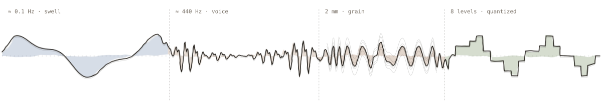

<picture>
  <source media="(prefers-color-scheme: dark)" srcset="wave-dark.svg">
  
</picture>

### Beckett Dillon

Applied AI engineer. I learn how a system behaves, whether it is a watershed, a song or a language model, and build tools that work with it.

Right now I am a Senior Forward Deployed AI Engineer and AI Consultant at Adobe, embedded with enterprise customers across the Adobe stack: Photoshop, Illustrator and Premiere Pro plugins, Firefly Services and the Photoshop and InDesign APIs, App Builder backends, Firefly Creative Production workflows and AEM. That client work is private, so the case studies live on [my site](https://beckett-dillon.com/work).

Before code I led habitat restoration crews and planted more than 250,000 trees, built heirloom furniture and wrote more than 300 commissioned songs. I am open to new roles in climate, agriculture and conservation tech, creative and audio tools, and applied AI anywhere it has to hold up in production.

[beckett-dillon.com](https://beckett-dillon.com) · [LinkedIn](https://www.linkedin.com/in/beckettdillon/) · [Hugging Face](https://huggingface.co/Severian) · [Email](mailto:beckettdillon42@gmail.com)

#### Open source

| | | |
|---|---|---|
| [GraphRAG-Local-UI](https://github.com/severian42/GraphRAG-Local-UI) | Microsoft’s GraphRAG on local models through Ollama and LM Studio, with indexing, prompt tuning, query and graph views | 2,321 stars · 291 forks |
| [Vodalus Expert LLM Forge](https://github.com/severian42/Vodalus-Expert-LLM-Forge) | Builds fine-tuning datasets grounded in RAG and Wikipedia, then trains on them with MLX and Unsloth | 195 stars |
| [MoA-Ollama-Chat](https://github.com/severian42/MoA-Ollama-Chat) | Mixture-of-agents for local models: several small models draft and one aggregates | 116 stars |
| [BDH-MLX](https://github.com/severian42/BDH-MLX) | Pathway’s Dragon Hatchling architecture ported from PyTorch to Apple MLX, at about twice the training throughput | |
| [Mycomind Daemon](https://github.com/severian42/Mycomind-Daemon-Ollama-Mixture-of-Memory-RAG-Agents) | A local assistant that pairs several models with memory, retrieval and web search | |
| [Firewatch](https://github.com/severian42/Firewatch) | A civil-rights companion in 13 languages ([live](https://firewatch-ice.vercel.app)) | |

#### Open models

46 models and 7 datasets on [Hugging Face](https://huggingface.co/Severian) with 188,000 downloads, plus 138,000 more on community re-quantizations. The best known is [ANIMA](https://huggingface.co/Severian/ANIMA-Phi-Neptune-Mistral-7B), a 7B model fine-tuned to reason through biomimicry: how living systems already solve an engineering problem.

#### Off the keyboard

Four-colour PETG prints on a Bambu Lab H2S, furniture from blueprints, and [music](https://open.spotify.com/artist/0WAAOmZcou75sYvsUAOpF7).
