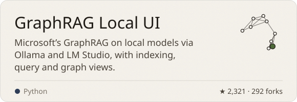
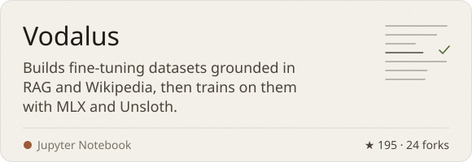
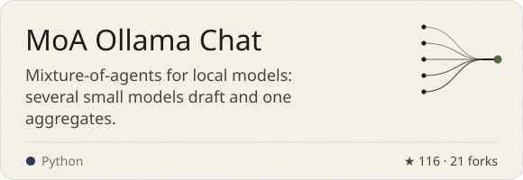
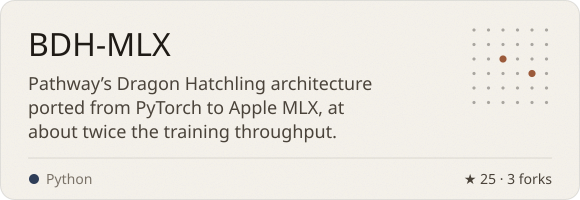
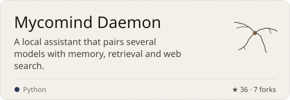
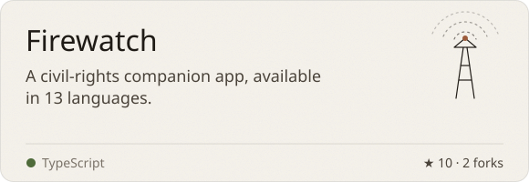

I am a Senior Forward Deployed AI Engineer and AI Consultant at Adobe, embedded with enterprise customers across the Adobe stack: Photoshop, Illustrator and Premiere Pro plugins, Firefly Services and the Photoshop and InDesign APIs, App Builder backends, Firefly Creative Production workflows and AEM. That client work is private, so the case studies live on [my site](https://beckett-dillon.com/work).

Before code I led habitat restoration crews and planted more than 250,000 trees, built heirloom furniture and wrote more than 300 commissioned songs. I am open to new roles in climate, agriculture and conservation tech, creative and audio tools, and applied AI anywhere it has to hold up in production.

**[beckett-dillon.com](https://beckett-dillon.com)** · [LinkedIn](https://www.linkedin.com/in/beckettdillon/) · [Hugging Face](https://huggingface.co/Severian) · [Email](mailto:beckettdillon42@gmail.com) · [Music](https://open.spotify.com/artist/0WAAOmZcou75sYvsUAOpF7)

 

 

 

 

 

<b>How these cards are made</b>

 

Every card on this page is drawn by [`tools/build.ts`](tools/build.ts) in the same ink and pigments as [beckett-dillon.com](https://beckett-dillon.com), with the fonts subset and embedded. A [GitHub Action](.github/workflows/refresh.yml) redraws them each morning from the GitHub and Hugging Face APIs, so the star counts and the forest stay current. Each tree grows from a seed taken from the model’s name, using the same generator as the printable tree hidden on my site.

